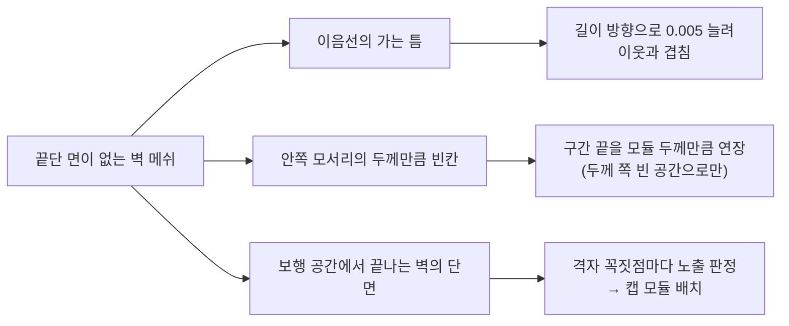
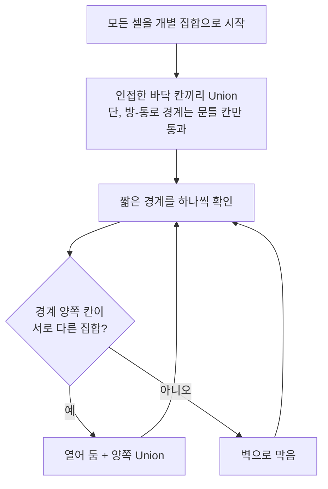

# Procedural 3D Map Baker

백룸풍 1:3 비대칭 서바이벌 PvP의 2D 절차적 맵 생성 결과를 3D 모듈러 프리팹(바닥 · 벽 · 문틀 · 천장) 맵으로 베이크하는 시스템입니다.

- **개발**: 5인 팀 (기획 2 · 프로그래밍 2 · 아트 1) / 프로그래머로 참여 · 팀 프로젝트 코드명 ProjectFS
- **기간**: 2026.09
- **환경**: Unity 6 (URP Render Graph), C#, FishNet
- 이 저장소는 팀 프로젝트 중 **본인이 담당한 코드**만 발췌했습니다. 2D 절차적 맵 생성([Asymmetric-PvP-FishNet](https://github.com/Youngdu-Min/Asymmetric-PvP-FishNet))을 3D 맵으로 전환한 작업입니다.

## 핵심 문제 해결

### 1. 벽 배치: 끝단 면이 없는 벽 메쉬 때문에 이음선·안쪽 모서리·벽 끝에 틈이 보이던 문제

**문제**: 사용한 벽 메쉬에는 끝단 면이 없어서, 모듈끼리 딱 맞붙이면 이음선에 머리카락 같은 틈이 생기고 그 사이로 벽 속이 비쳐 보였습니다. 두 벽이 직각으로 만나는 안쪽 모서리에는 두께만큼 빈칸이 생기고, 보행 공간에서 끝나는 벽은 단면이 뚫려 보였습니다.

**해결**: 모든 벽·문틀을 길이 방향으로 `m_seamOverlap`(기본 0.005유닛)만큼 늘려 이웃과 살짝 겹치게 했습니다. 구간 끝 다음 칸이 벽 양쪽 모두 보행 불가일 때만 안쪽 모서리로 판정해 구간 끝을 모듈 두께만큼 늘리므로 보행 공간을 침범하지 않습니다. 모듈 두께는 자식 메쉬 경계로 재서 캐시하고, 한쪽만 늘린 경우 늘린 길이 차이의 절반만큼 위치를 옮깁니다. 벽을 놓을 때마다 셀 경계와 두께 방향을 기록해 두고, 모든 격자 꼭짓점에서 반대쪽에 같은 두께 방향으로 이어지는 벽이 없고 끝단 앞이 바닥인 곳에 캡을 붙입니다.

**결과**: 이음선과 안쪽 모서리의 틈이 메워지고, 방-통로 경계 벽과 일반 벽의 두께 방향이 뒤집히는 지점처럼 노출된 벽 끝에 캡이 배치됩니다. 연장 횟수와 캡 개수는 진단 로그로 남깁니다.

관련 코드: [`SpawnLinearModule`](01_LevelGeneration_3D/PrefabBakeTestRunner.cs#L566) (이음선 겹침·모서리 연장) · [`IsExposedWallEnd`](01_LevelGeneration_3D/PrefabBakeTestRunner.cs#L647) (노출 판정) · [`LevelModule.cs`](02_LevelModule/LevelModule.cs) (메쉬 경계 실측)

### 2. 방-통로 경계: 짧은 경계를 모두 열면 틈이 남고, 모두 막으면 방이 고립되는 문제

**문제**: 2D 맵의 통로는 방 테두리 아무 곳에나 닿을 수 있어, 길이 1인 경계(모서리 접촉 등)나 맞는 문틀이 없는 짧은 경계가 생깁니다. 이런 경계를 모두 열면 벽에 문틀 없는 틈이 남고, 모두 막으면 그 경계로만 이어지던 방이나 통로가 고립됩니다.

**해결**: 짧은 경계를 모두 막은 상태에서 시작해, 인접한 바닥 칸끼리 Union-Find로 묶은 뒤 짧은 경계를 하나씩 확인합니다. 경계 양쪽이 서로 다른 집합일 때만 열고 합칩니다. 크루스칼 알고리즘이 사이클을 만드는 간선을 버리는 것과 같은 방식으로, 이미 다른 경로로 이어진 곳의 경계는 막고 처음으로 두 영역을 잇는 경계만 남깁니다. `Find`에는 경로 압축을 적용했습니다.

**결과**: 짧은 경계를 전부 열었을 때와 연결 상태는 같고, 여는 경계 수는 최소가 됩니다. 막은 개수와 열어 둔 개수는 로그로 남깁니다.

관련 코드: [`FindShortRunsToKeepOpen`](01_LevelGeneration_3D/PrefabBakeTestRunner.cs#L460) · [`Find` / `Union`](01_LevelGeneration_3D/PrefabBakeTestRunner.cs#L607)

## 구현 범위

- **3D 맵 베이크**: 2D 그리드 생성 결과를 3D 모듈러 프리팹(바닥 · 벽 · 문틀 · 천장)으로 배치하고, 시드만 동기화해 호스트·클라이언트가 같은 배치를 만듦
- **맵 종류별 가중치**: 모듈 프리팹을 가중 랜덤으로 골라 빈칸 없이 채움
- **LevelModule 툴**: 모듈러 프리팹 제작 규격 검증, 에셋 이름을 해석해 래퍼 프리팹을 일괄 생성하는 에디터 툴
- **Convolution 포스트 프로세싱**: URP Render Graph 기반 커널 합성곱 필터로 화면 연출

## 코드 구성

| 폴더 | 설명 |
|---|---|
| `01_LevelGeneration_3D` | `GridToWorld`: 그리드 좌표를 월드 좌표로 변환합니다. `PrefabBaker`: 바닥 → 벽 2단계 배치. `PrefabBakeTestRunner`: 경계 방향별 벽·문틀 배치, 크루스칼 방식으로 고립되는 짧은 경계만 개방, 가중 랜덤 모듈 채움, 통행 불가 모듈 영역 제한, 전용 난수로 배치 순서 보호 |
| `02_LevelModule` | `LevelModule`: 피벗·마감면·돌출 허용치 같은 모듈 규격을 검사합니다. `Editor/LevelModuleWrapperGenerator`: 에셋 이름(크기·종류)을 해석해 래퍼 프리팹을 일괄 생성·갱신합니다. |
| `03_ConvolutionFilter` | Renderer Feature, Render Graph Pass, 커널 정의(3x3 / 5x5, 흑백 변환 옵션), 합성곱 셰이더 |

## 기술 문서

모듈 규격과 래퍼 자동 생성, 바닥 패킹, 벽·문틀 배치(이음선·모서리·끝단 캡), Union-Find 기반 짧은 경계 처리, NavMesh, 호스트/클라이언트 결정적 배치, Render Graph 합성곱 필터는 [기술 문서](docs/TechnicalDesign.md)에 정리했습니다.

## 참고 자료

- Convolution 커널 종류와 가중치: Jephraim Manansala, [Image Processing with Python: Image Effects using Convolutional Filters and Kernels](https://medium.com/swlh/image-processing-with-python-convolutional-filters-and-kernels-b9884d91a8fd), The Startup, 2021-01-28
