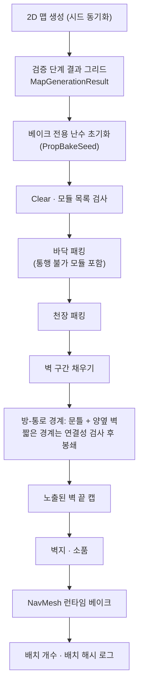
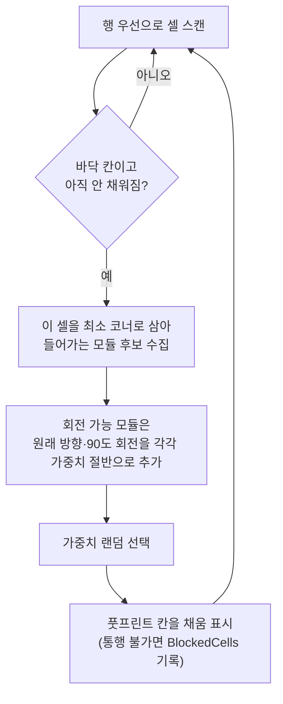
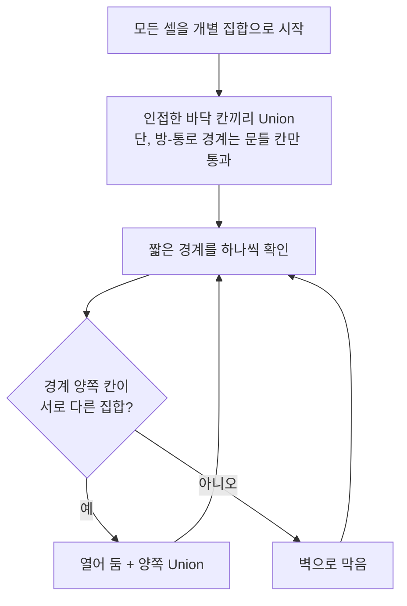
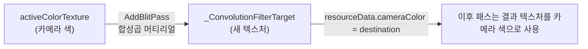

# Procedural 3D Map Baker — 기술 문서

[← README로 돌아가기](../README.md)

## 목차

1. [설계 목표](#1-설계-목표)
2. [전체 흐름](#2-전체-흐름)
3. [좌표계와 모듈 규격](#3-좌표계와-모듈-규격)
4. [래퍼 프리팹 자동 생성](#4-래퍼-프리팹-자동-생성)
5. [바닥·천장 패킹](#5-바닥천장-패킹)
6. [벽 배치](#6-벽-배치)
7. [방-통로 경계와 문틀](#7-방-통로-경계와-문틀)
8. [벽지·소품](#8-벽지소품)
9. [NavMesh](#9-navmesh)
10. [결정적 배치와 검증](#10-결정적-배치와-검증)
11. [Convolution 포스트 프로세싱](#11-convolution-포스트-프로세싱)
12. [외부 의존성](#12-외부-의존성)
13. [한계와 개선 방향](#13-한계와-개선-방향)

---

## 1. 설계 목표

2D 절차적 맵 생성 결과(그리드)를 3D 모듈러 프리팹 맵으로 바꾸는 작업입니다. 2D 생성 파이프라인은 [Asymmetric-PvP-FishNet 기술 문서](https://github.com/Youngdu-Min/Asymmetric-PvP-FishNet/blob/main/docs/TechnicalDesign.md#3-2d-절차적-맵-생성)에 정리했습니다.

| 목표 | 설계 방식 |
|---|---|
| 2D 생성 결과 재사용 | 생성 알고리즘은 그대로 두고, 검증까지 끝난 **그리드·방 목록·시작/목표 결과**만 입력으로 받아 3D로 변환 |
| 호스트와 클라이언트의 같은 배치 | 시드만 동기화하고 각 머신이 직접 베이크. **베이크 전용 난수**, 고정된 순회 순서, **배치 해시 로그**로 결과가 같은지 확인 |
| 에셋 교체에 강한 배치 코드 | 배치 코드는 `LevelModule`의 **종류·크기**만 봄. 실제 아트 에셋은 래퍼 프리팹 안에 들어감 |
| 에셋 제작 규칙 자동 검증 | 피벗·마감면·크기를 메쉬 경계로 실측해 규칙을 어기면 실측값과 함께 경고 |
| 빈칸·틈 없는 맵 | 1칸 모듈 존재 검사, 이음선 겹침, 안쪽 모서리 연장, 노출된 벽 끝 캡 |
| 연결성 유지 | 짧은 방-통로 경계를 막을 때 **Union-Find로 고립 여부를 검사**해 필요한 곳만 열어 둠 |

---

## 2. 전체 흐름

맵 생성이 끝나면 `PrefabBakeTestRunner.Bake()`가 아래 순서로 3D 맵을 만듭니다.



| 단계 | 메서드 | 결과 |
|---|---|---|
| 바닥 | `BakeFloor` → `PackFloorModules` | 바닥 칸을 크기가 다른 바닥 모듈로 빈칸 없이 채움. 구멍 모듈이 막은 칸은 `BlockedCells`에 기록 |
| 천장 | `BakeCeiling` → `PackFloorModules` | 같은 패킹을 벽 높이(3)에서 한 번 더 |
| 벽 | `BakeWalls` | 바닥과 빈 공간 사이 경계를 벽 모듈로 채움 |
| 문틀 | `BakeDoorFrames` | 방과 통로가 맞닿는 경계에 문틀을 놓고, 문틀을 둘 수 없는 짧은 경계를 처리 |
| 끝단 캡 | `BakeWallEndCaps` | 벽 끝이 보행 공간에 드러나는 꼭짓점에 캡 |
| 장식 | `BakeWallpaper`, `BakeProps` | 확률적 벽지 교체, 방 안 소품 |
| 내비게이션 | `BakeNavMesh` | 바닥은 보행 가능, 벽은 보행 불가 영역으로 런타임 베이크 |

---

## 3. 좌표계와 모듈 규격

### 3.1 그리드 → 월드

1셀 = 1유닛이며, 2D 타일맵과 1:1로 대응합니다. 그리드 `(x, y)`는 월드 `(x, groundY, y)`가 됩니다.

```csharp
public static Vector3 CellCenterToWorld(Vector2Int cell, float cellSize = 1f, float groundY = 0f)
    => new Vector3((cell.x + 0.5f) * cellSize, groundY, (cell.y + 0.5f) * cellSize);
```

바닥 모듈은 **셀 위에**, 벽·문틀 모듈은 **셀 경계선 위에** 놓입니다. 2D에서는 벽이 한 칸을 차지했지만, 3D에서는 벽이 바닥 칸 사이의 선에 서므로 바닥 칸을 줄이지 않습니다.

### 3.2 `LevelModule`: 조합 프리팹의 메타데이터

모든 모듈 프리팹 루트에 붙는 컴포넌트입니다. 배치 코드는 이 값만 읽습니다.

| 필드 | 내용 |
|---|---|
| `Kind` | `Floor` · `Wall` · `DoorFrame` · `EndCap` |
| `Size` | 셀 단위 크기. Floor는 (가로 X, 세로 Z), 벽 계열은 (폭, 높이) |
| `AllowRotate90` | Floor 전용. 90도 회전 배치 허용 |
| `BlocksMovement` | Floor 전용. 구멍처럼 지나갈 수 없는 바닥 |

| 종류 | 피벗 | 마감면 |
|---|---|---|
| Floor | 풋프린트 중앙, 윗면 Y=0 | — |
| Wall · DoorFrame | 폭 중앙의 하단, 셀 경계선 위 | 로컬 +Z (두께는 -Z 방향) |
| EndCap | 벽 끝점, 셀 경계선 위 | 벽은 -X 쪽, 캡은 +X로 돌출 |

벽 높이는 `WALL_HEIGHT = 3`으로 고정합니다. 천장도 이 높이에 놓입니다.

### 3.3 제작 규칙 검증

`OnValidate()`에서 **프리팹 에셋이나 프리팹 편집 모드일 때만** 검사합니다. 씬에 배치된 인스턴스까지 검사하면 베이크할 때마다 경고가 대량으로 쏟아지기 때문입니다.

- Size는 1 이상, 루트 scale은 (1,1,1), 벽 계열 높이는 3
- `TryGetLocalMeshBounds()`: 자식 메쉬 경계의 꼭짓점 8개를 루트 로컬 좌표로 변환해 모듈 전체 경계를 구합니다. 자식에 회전·스케일이 있어도 정확합니다.
- `GetBoundsIssues()`: 종류별 규칙과 실측 경계를 비교합니다.

| 검사 | 기준 |
|---|---|
| `CheckSpan` (폭·깊이) | 중앙 피벗 기준으로 한쪽 끝이 ±0.05 안에서 맞아야 함. 반대쪽 돌출은 0.2까지 허용 (크랙 조각, 파편, 문틀 케이싱 등) |
| `CheckEdge` (하단·윗면·마감면) | 기준값 ±0.05. 돌출을 허용하는 면은 +0.2까지 |

경고 메시지에는 기대값과 실측값을 함께 넣었습니다(`폭(X) 기대 -0.5~0.5, 실측 -0.512~0.6`). 아트 담당이 메시지만 보고 무엇을 고칠지 알 수 있게 하기 위해서입니다. 선택하면 기즈모로 풋프린트와 마감면 방향(노란 선)을 보여 줍니다.

---

## 4. 래퍼 프리팹 자동 생성

`LevelModuleWrapperGenerator` (메뉴 `Tools/Level Generation/Generate BR Level Modules`)

서드파티 백룸 에셋 팩의 바닥·벽 프리팹 수십 개를 하나씩 래퍼로 감싸면 실수가 생기기 쉽습니다. 그래서 **프리팹 이름을 파싱해** `LevelModule` 래퍼를 일괄 생성합니다.

### 4.1 이름 규칙

| 정규식 | 종류 | 크기 |
|---|---|---|
| `^BR_Floor_(depth)x(width)(_접미사)?$` | Floor | 이름은 Z×X 순서라 `(width, depth)`로 뒤집어 저장 |
| `^BR_Wall_(A\|B)_3x(width)(_접미사)?$` | Wall. 접미사가 `_Door`로 시작하면 DoorFrame | `(width, 3)` |
| `^BR_Wall_(A\|B)_Edge_3m$` | EndCap | `(1, 3)` |

- 크기는 한 자리 정수만 매칭합니다. 접미사는 영문자로 시작해야 하므로 `1x1_5`(1.5칸), `3x05`(0.5칸) 같은 비정수 크기는 자동으로 빠집니다.
- 높이가 3이 아닌 벽(예: 2.75m `_Alt` 캡)도 제외합니다.
- 이름에 `_Hole`이 들어간 바닥은 처음 생성할 때 `BlocksMovement`를 켭니다.

### 4.2 마감면 맞추기

원본 벽 메쉬는 피벗이 두께 중앙에 있습니다. 규격은 마감면이 Z=0이어야 하므로, 원본을 자식으로 넣고 **같은 스타일의 기본 벽(`BR_Wall_{스타일}_3x1`) 두께의 절반**만큼 -Z로 옮깁니다. 문·창 벽은 케이싱이 튀어나와 있어 그 메쉬로 재면 두께가 부풀려지므로, 벽체만 있는 기본 벽을 기준으로 삼았습니다.

캡은 +X로 돌출해야 합니다. 원본 메쉬 중심이 -X 쪽에 있으면 Y축으로 180도 돌립니다. 두께가 Z축 대칭이라 돌려도 마감면 위치는 그대로입니다.

### 4.3 검증과 제자리 갱신

- 래퍼를 만든 뒤 `GetBoundsIssues()`로 검사하고, 규칙을 어기면 이유를 로그로 남기고 저장하지 않습니다.
- 이미 있는 래퍼는 **새로 만들지 않고 제자리에서 갱신**합니다(`LoadPrefabContents`). 덮어쓰면 씬의 모듈 목록 배열이 참조하던 fileID가 끊기고, 사람이 직접 켜 둔 `AllowRotate90`·`BlocksMovement`가 초기화되기 때문입니다.

---

## 5. 바닥·천장 패킹

### 5.1 알고리즘



- 행 우선으로 훑기 때문에 처음 만나는 빈 셀은 항상 그 모듈이 놓일 영역의 **최소 코너**입니다. 그래서 "이 셀부터 오른쪽·위쪽으로 들어가는가"만 검사하면 됩니다.
- **1×1 모듈이 있으면 빈칸 없이 끝납니다.** 어떤 셀이든 최소한 1×1은 들어가기 때문입니다. 베이크를 시작할 때 목록에 1칸 모듈이 없으면 경고하고, 끝난 뒤 채운 칸 수가 바닥 칸 수와 다르면 다시 경고합니다.
- 회전 가능한 모듈은 두 방향을 각각 **가중치 절반**으로 넣습니다. 회전을 허용해도 그 모듈의 전체 등장 비율이 늘어나지 않게 하기 위해서입니다.
- 천장도 같은 패킹을 벽 높이에서 실행합니다. 천장에는 통행 제한이 없으므로 마스크를 쓰지 않습니다.

### 5.2 통행 불가 바닥(구멍)

구멍 모듈은 **풋프린트 전체가 허용 마스크 안에 들어갈 때만** 후보가 됩니다.

- 허용 영역은 시작 방과 목표 방을 뺀 방들의 가장자리에서 `m_holeRoomMargin`칸(기본 2) 안쪽입니다.
- 방 테두리 띠가 항상 비어 있으므로, 구멍이 어디에 생기든 **방의 모든 출입구는 서로 이어진 상태**로 남습니다. 기본값 2는 NavMesh 에이전트 반경 0.5를 기준으로 정했습니다.
- 구멍이 차지한 칸은 `MapGenerationResult.BlockedCells`에 기록합니다. 소품 배치와 스폰 후보 선정에서 이 칸을 뺍니다.

---

## 6. 벽 배치

### 6.1 경계 구간 수집

```csharp
private static bool IsWallEdge(MapCellType self, MapCellType neighbor) => IsFloor(self) && neighbor == MapCellType.None;
```

네 방향 각각에 대해, 한 줄씩 훑으며 "바닥 칸이고 그 방향 이웃이 빈 칸"인 셀이 연속된 구간을 `EdgeRun(FixedCoord, Start, Length)`으로 묶습니다. 고정축 → 가변축 순서로 훑으므로 결과 순서가 항상 같습니다.

방향마다 회전값이 정해져 있어, 모듈 마감면(로컬 +Z)이 항상 방 안쪽을 향합니다.

### 6.2 구간 채우기

구간의 남은 길이 이하인 벽 모듈 중에서 가중치 랜덤으로 하나를 골라 놓고, 남은 길이가 0이 될 때까지 반복합니다. 폭 1인 벽 모듈이 있으면 어떤 길이든 끝까지 채울 수 있습니다.

### 6.3 이음선 겹침과 안쪽 모서리 연장

사용한 벽 메쉬에는 **끝단 면이 없습니다.** 모듈끼리 딱 맞붙이면 이음선에 머리카락 같은 틈이 생기고, 그 사이로 벽 속이 비쳐 보입니다.

| 문제 | 처리 |
|---|---|
| 이음선 균열 | 모든 벽·문틀을 길이 방향으로 `m_seamOverlap`(기본 0.005유닛)만큼 늘려 이웃과 살짝 겹치게 함 |
| 안쪽 모서리 빈칸 | 두 벽이 직각으로 만나는 안쪽 모서리에는 두께만큼 빈칸이 생김. 구간 끝을 **모듈 두께만큼 더 늘려** 빈칸을 채우고 서로의 끝을 파묻음 |

```csharp
// 구간 끝 다음 칸이 벽 양쪽(바닥 쪽·두께 쪽) 모두 보행 불가면 안쪽 모서리
private static bool IsInnerCornerEnd(MapGrid grid, Vector2Int dir, int fixedCoord, int nextVariableCoord)
{
    Vector2Int nextCell = RunCell(dir, fixedCoord, nextVariableCoord);
    return !IsFloor(grid[nextCell]) && !IsFloor(grid[nextCell + dir]);
}
```

- 이 조건일 때 모서리 빈칸은 두께 쪽 빈 공간에 생깁니다. 그래서 늘려도 보행 공간을 침범하지 않습니다.
- 모듈 두께는 자식 메쉬 경계의 Z 크기로 재고, 모듈별로 캐시합니다.
- 한쪽만 늘리면 모듈 중심이 어긋나므로, 늘린 길이 차이의 절반만큼 위치를 옮깁니다.

### 6.4 노출된 벽 끝 캡

끝단 면이 없는 벽이 보행 공간에서 끝나면 단면이 뚫려 보입니다. 이런 꼭짓점을 찾아 캡 모듈을 붙입니다.

**경계 키:** 셀 경계 한 칸을 `Vector3Int`로 표현합니다. `z=0`이면 가로선 y 위의 `[x, x+1]`, `z=1`이면 세로선 x 위의 `[y, y+1]`입니다. 벽을 놓을 때마다 `m_wallEdges[키] = 두께 방향(+1/-1)`을 기록합니다.

**노출 판정:** 모든 격자 꼭짓점에서 동서남북 네 반변을 검사합니다. 아래 조건을 모두 만족하면 노출된 끝입니다.

1. 이 반변에 벽이 있다.
2. 반대쪽 반변에 **같은 두께 방향으로** 이어지는 벽이 없다.
3. 두께 쪽으로 수직인 벽이 없다 (있으면 그 벽 몸체가 끝을 가림).
4. 끝단 앞 셀이 바닥이다 (보행 불가면 아무도 볼 수 없음).

대표적인 사례는 방-통로 경계 벽(두께가 통로 쪽)과 일반 벽(두께가 빈 공간 쪽)이 한 직선에서 만나 **두께 방향이 뒤집히는** 지점입니다. 캡은 두께 방향에 맞춰 회전하고, 돌출 방향이 맞지 않으면 X축으로 반전합니다.

---

## 7. 방-통로 경계와 문틀

방 칸과 통로 칸이 맞닿은 경계(`IsDoorEdge`)는 일반 벽과 따로 처리합니다. 2D 맵의 통로는 방 테두리 아무 곳에나 닿을 수 있어서, 경계 길이가 1칸인 곳부터 방 한 변 전체인 곳까지 다양합니다.

### 7.1 문틀 배치

- 길이 2 이상인 경계: 폭이 경계 길이 이하인 문틀 모듈 중 가중치 랜덤으로 하나를 골라 **정중앙**에 놓고, 양옆을 벽으로 채웁니다.
- 문틀이 경계 끝에 닿고 그 끝이 안쪽 모서리면, 문틀 자체를 모서리까지 늘립니다.
- 길이 1인 경계(모서리 접촉 등)나 맞는 문틀이 없는 경계는 **짧은 경계**로 분류합니다.

### 7.2 짧은 경계: 막을까, 열어 둘까

짧은 경계를 모두 열어 두면 벽에 문틀 없는 틈이 남습니다. 모두 막으면 그 경계로만 이어지던 방이나 통로가 고립됩니다. 그래서 **고립을 막는 데 꼭 필요한 경계만** 열어 둡니다.



- 크루스칼 알고리즘이 사이클을 만드는 간선을 버리는 것과 같은 방식입니다. 이미 다른 경로로 이어진 곳의 경계는 막고, 처음으로 두 영역을 잇는 경계만 남깁니다.
- 결과적으로 **짧은 경계를 전부 열었을 때와 연결 상태는 같고, 여는 경계 수는 최소**가 됩니다.
- `Find`는 경로 압축을 적용했습니다. 막은 개수와 열어 둔 개수를 로그로 남깁니다.

---

## 8. 벽지·소품

2D 베이크의 배치 규칙을 3D 좌표로 옮겼습니다.

- **벽지:** 방마다 `m_roomWallpaperChance`(기본 30%), 통로(필수·선택)마다 `m_corridorWallpaperChance`(기본 15%) 확률로 그 영역에 붙은 벽 그룹을 교체합니다.
- **소품:** 방의 테두리 1칸을 뺀 안쪽 칸 중에서 고릅니다. 목표 오브젝트가 차지한 칸과 구멍 칸(`BlockedCells`)은 처음부터 제외하고, 소품을 하나 놓을 때마다 주변 `m_minPropDistance`칸 안의 후보를 지웁니다. 방마다 최대 `m_maxPropsPerRoom`개입니다.

두 배치 모두 [10장](#10-결정적-배치와-검증)의 베이크 전용 난수를 씁니다.

---

## 9. NavMesh

`NavMeshBuilder`로 런타임에 굽습니다.

| 소스 | 영역 |
|---|---|
| 바닥 루트의 렌더 메쉬 | 기본(보행 가능) |
| 벽 루트의 렌더 메쉬 | `Not Walkable` (영역 1) |

**벽을 보행 불가 소스로 넣는 이유:** [3.1](#31-그리드--월드)처럼 3D에서는 벽이 셀 경계선 위에 서고, 그 아래로 바닥이 이어집니다. 바닥만 수집하면 방-통로 경계를 막은 채움 벽 아래로 NavMesh가 이어져, AI가 벽을 통과하는 경로를 찾습니다.

- 굽기 범위는 맵 크기에 외곽 여백(`m_mapBorderPadding`)을 더한 영역입니다.
- 다시 굽기 전과 `OnDestroy()`에서 기존 NavMesh 데이터를 모두 제거해, 이전 맵의 NavMesh가 남지 않게 합니다.

---

## 10. 결정적 배치와 검증

이 프로젝트는 맵 데이터를 보내지 않고 시드만 FishNet으로 동기화합니다. 따라서 호스트와 모든 클라이언트가 **같은 시드로 같은 배치**를 만들어야 합니다.

### 10.1 베이크 전용 난수

```csharp
// 전역 UnityEngine.Random과 분리 — 생성된 프리팹의 Awake/OnEnable이 난수 순서를 흐트러뜨리지 않도록
m_bakeRandom = new SystemRandomSource(mapResult.PropBakeSeed);
```

베이크 도중에 생성되는 프리팹의 `Awake`·`OnEnable`이 `UnityEngine.Random`을 쓰면 전역 난수 순서가 바뀝니다. 그러면 머신마다 다음 모듈 선택이 달라질 수 있습니다. 그래서 모듈 선택, 벽지, 소품은 모두 생성 결과에 담긴 `PropBakeSeed`로 만든 별도 난수만 사용합니다.

여기에 더해 바닥 패킹과 벽 구간 수집은 행 우선, 방향은 고정 순서로 돕니다.

### 10.2 배치 해시

```csharp
hash = hash * 31 + StableHash(prefab.name);
hash = hash * 31 + Mathf.RoundToInt(position.x * 100f);
hash = hash * 31 + Mathf.RoundToInt(position.y * 100f);
hash = hash * 31 + Mathf.RoundToInt(position.z * 100f);
hash = hash * 31 + Mathf.RoundToInt(rotation.eulerAngles.y);
```

- 모든 생성은 `Spawn()` 한 곳을 거치며, 프리팹 이름·위치(0.01 단위 반올림)·Y 회전을 해시에 누적합니다.
- 프리팹 이름은 `string.GetHashCode()` 대신 **FNV-1a**로 해싱합니다. `GetHashCode()`는 런타임이나 프로세스마다 값이 달라질 수 있어 머신 간 비교에 쓸 수 없습니다.
- 베이크가 끝나면 `Placed=개수 PlacementHash=해시`를 로그로 남깁니다. 호스트와 클라이언트 로그의 두 값이 같으면 배치가 같다는 뜻입니다.

### 10.3 진단 로그

| 로그 | 의미 |
|---|---|
| `{label} 패킹 불완전: 셀 N개 중 M개만 채움` | 1칸 모듈이 빠져 빈칸이 생김 |
| `통행 불가 모듈 N개 배치, 막힌 셀 M개` | 구멍 배치 결과 |
| `안쪽 모서리 벽 끝 연장 N개` | 모서리 연장 횟수 |
| `노출된 벽 끝단 캡 N개 배치` | 캡 배치 결과 |
| `문틀 없는 방-통로 경계: 벽으로 막음 N개, 열어둠 M개` | 짧은 경계 처리 결과 |
| `{label} 목록에 Kind=... 모듈 포함 — 무시됨` | 모듈 목록에 다른 종류의 모듈이 섞임 |

---

## 11. Convolution 포스트 프로세싱

URP Render Graph로 만든 커널 합성곱 화면 필터입니다. 프로젝트에서는 글로벌 볼륨에 Gaussian Blur 5×5를 Film Grain, Vignette와 함께 걸어 화면 분위기를 만드는 데 썼습니다.

### 11.1 구성

| 클래스 | 역할 |
|---|---|
| `ConvolutionFilter` (`VolumeComponent`) | Volume에서 조정하는 값: 커널 종류, 원본과 섞는 비율(`Intensity`), 샘플 간격(`SampleDistance`, 1~8픽셀) |
| `ConvolutionFilterFeature` (`ScriptableRendererFeature`) | 셰이더로 머티리얼을 만들고 패스를 등록. 기본 실행 시점은 URP 후처리가 끝난 뒤 |
| `ConvolutionFilterPass` (`ScriptableRenderPass`) | Render Graph에 블릿 패스를 기록 |
| `ConvolutionKernels` | 커널 가중치 정의 |
| `ConvolutionFilter.shader` | 5×5 합성곱 |

### 11.2 Render Graph 패스



- **건너뛰는 경우:** Volume 값이 비활성(`Intensity` 0 또는 Identity), 카메라 후처리 꺼짐, 프리뷰·반사 카메라, 백버퍼에 직접 그리는 경우
- `requiresIntermediateTexture = true`로 카메라 색을 텍스처로 읽을 수 있게 합니다.
- 결과를 원래 텍스처에 다시 복사하지 않고 **카메라 색 핸들 자체를 결과 텍스처로 교체**합니다. 블릿 한 번으로 끝납니다.
- 텍스처 크기가 상대값(스케일)으로 잡혀 있으면 `width`가 0일 수 있어, 그때는 카메라 타깃 크기를 씁니다.
- 셰이더는 Feature에 직접 참조로 저장합니다. `Shader.Find`는 빌드에 셰이더가 포함된다는 보장이 없어서, 에디터에서 Feature를 추가할 때 찾아서 참조로 저장해 둡니다.

### 11.3 셰이더

- 커널 배열을 **5×5(25개) 하나로 고정**하고, 3×3 커널은 가운데에 넣고 나머지를 0으로 채웁니다. 셰이더 하나로 모든 커널을 처리하고, 반복문은 `[unroll]`로 펼칩니다.
- 화면 위쪽이 UV의 -V인 플랫폼(D3D 등)에서는 세로 오프셋 부호를 뒤집습니다(`UNITY_UV_STARTS_AT_TOP`). Sobel처럼 방향이 있는 커널이 플랫폼마다 위아래가 바뀌지 않게 하기 위해서입니다.
- 엣지·Sobel 계열은 샘플을 흑백으로 바꾼 뒤 적용합니다.
- 결과를 0~1로 자른 뒤 `Intensity` 비율로 원본과 섞습니다.

### 11.4 커널

| 분류 | 커널 |
|---|---|
| 엣지 | EdgeDetection1 (4-이웃), EdgeDetection2 (8-이웃) |
| 방향 미분 | Sobel Top / Bottom / Left / Right |
| 강조 | Sharpen, Emboss, Unsharp Masking 5×5 |
| 블러 | Box Blur, Gaussian Blur 3×3, Gaussian Blur 5×5 |

커널은 **적힌 방향 그대로 적용**합니다(상관 연산). 참고한 글은 scipy 합성곱을 써서 커널을 뒤집어 적용하므로, 결과는 미리 뒤집어 넘긴 것과 같습니다.

---

## 12. 외부 의존성

이 저장소는 팀 프로젝트에서 3D 맵 작업만 발췌했습니다.

| 항목 | 위치 |
|---|---|
| `MapGrid`, `MapCellType`, `MapGenerationResult`, `MapGenerationMasterRunner`, `RoomData`, `StartGoalResult`, `IRandomSource`·`SystemRandomSource`, 단계별 테스트 러너 | 2D 맵 생성 코드. [Asymmetric-PvP-FishNet](https://github.com/Youngdu-Min/Asymmetric-PvP-FishNet)의 `04_LevelGeneration_2D` |
| `ObjectiveStateController` | 같은 저장소의 `01_EscapeSystem` |
| 백룸 에셋 팩(`BackroomsLikeAssetRe`) | 서드파티 유료 에셋. 포함하지 않음 |
| Unity 6 URP (Render Graph), AI Navigation | 패키지 |

---

## 13. 한계와 개선 방향

| 항목 | 현재 | 개선 방향 |
|---|---|---|
| 오브젝트 수 | 모듈마다 GameObject를 하나씩 생성함. 맵이 커지면 오브젝트와 드로우 콜이 함께 늘어남 (측정은 하지 않음) | 방 단위 메쉬 결합 또는 정적 배칭 |
| NavMesh 베이크 | `BuildNavMeshData`를 동기로 호출해 베이크 프레임에 멈춤이 생길 수 있음 | `UpdateNavMeshDataAsync`로 비동기 베이크 |
| 벽지 규칙 | 2D 규칙(아래쪽이 바닥인 벽 칸)을 그대로 옮겨, 3D에서 네 방향 벽면을 고르게 다루지 못함 | 벽 경계 키 기준으로 방향별 벽면에 배치 |
| 합성곱 샘플 수 | 3×3 커널도 25번 샘플링함 | 3×3 전용 패스 분리, Gaussian은 가로·세로 2패스로 분리 |
| 배치 일치 확인 | 호스트와 클라이언트 로그를 사람이 비교 | 배치 해시를 서버로 보내 자동 비교 |
